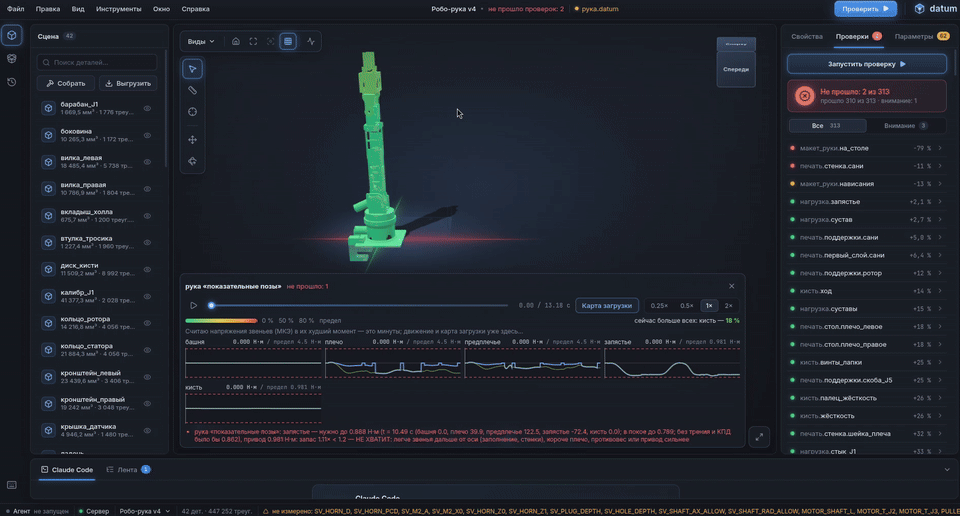

# Datum

[Русский](README.md) · **English**

**An AI-first engineering editor: an AI agent designs and computes, the human
sets the task and steers.** You say what you need — "an enclosure for this
board with a snap-fit lid", "an arm on two servos that lifts 100 g", "a cradle
for this scan" — and the agent builds the parts, records where every number
comes from, runs the checks and calculations, shows you the result in the
window and fixes whatever failed. You look, measure, adjust the intent and
decide when it is done.

Datum is built for the agent. Its operations are the agent's tools; checks
report a reason in words, not just "red"; the window is a shared workspace
where the agent sees what you see and can show you a part, a section or the
place where two parts collide. It is designed around
[Claude Code](https://claude.com/claude-code): it is docked in the window and
gets the design rules as a skill. Without an agent Datum is a library and a
set of commands, not an editor.



> A young, evolving project. Tested on Linux (x86-64). The interface, messages
> and most documentation are in Russian first.

## What working with it looks like

1. You open the window and describe the task to the agent in the dock.
2. The agent declares parameters with a provenance (measured, guessed with a
   range, derived by a formula, taken from a datasheet), writes parts as
   Python scripts and builds them.
3. It runs checks and calculations: does it assemble, does the snap fit hold,
   is the motor strong enough, will the link survive, will the part print.
   When something fails, it fixes it and runs again.
4. It does not guess the unknowns silently: a sweep shows which unmeasured
   number decides the outcome, and the agent asks you to measure exactly that.
5. Along the way it shows you the result in the window; you measure with the
   caliper, select a part, say "it is too thin here" — the agent sees what you
   mean.
6. When the project is done, an AI critic with a fresh context looks for what
   was missed; the output is files for manufacturing, a bill of materials and
   an assembly guide.

## Features

- **Parts and assemblies.** Solids come from the
  [manifold3d](https://github.com/elalish/manifold) kernel: primitives,
  booleans, chamfers and fillets, threads, text from fonts, field-based
  sculpting, pockets swept along the insertion path, cradles from a scan,
  Gridfinity. An assembly has an order, an insertion method (slides in or
  snaps in) and joints.
- **Machine elements.** A pin in a clevis (shear, bearing pressure, bending),
  a screw drive (efficiency, self-locking), beams, rolling bearings, column
  buckling, cams and wedges with friction, redundant constraints of a
  mechanism — each checked against every failure mode, not just one.
- **Strength.** The finite element method (P2 tetrahedra, fTetWild mesh) with
  a patch test on the same mesh; the answer is a bracket, not a single number,
  and sharp corners are recognised as singularities rather than strength.
- **Mechanisms.** MuJoCo simulation: actuator torque against the datasheet,
  tracking lag, stability or the load on the mount, collisions against the
  exact geometry, link stresses at the worst moment, backlash and friction
  when declared; export to animated GLB, MJCF and URDF.
- **Materials and purchased parts.** A catalogue of plastics (PLA, PETG, ABS,
  ASA, TPU) as project parameters; any other material through its own
  modulus, density and strength with a source, and your own measurement always
  overrides the catalogue. Purchased parts (servos, bearings, fasteners) take
  part in the assembly and the calculations, and a component library carries
  them between projects.
- **Numbers with provenance.** Every parameter is `measured`, `assumed` (with
  a range), `derived`, `standard` or `chosen`; a sweep over the guesses
  separates what must be measured from what is not worth measuring.
- **3D printing.** Printability in the print pose (walls, overhangs, bridges,
  cavities, first layer, strength between layers), 3MF and STL with the
  written file verified, slicing with the ElegooSlicer CLI and a
  layer-by-layer G-code report, mass from the print settings, test coupons
  for fits.
- **The window.** Electron + three.js: a slicer-style caliper, wall
  thickness, section view, exploded view, moving and rotating with the mouse,
  versions with shape comparison, a simulation player with a load map, and a
  feed of every action — yours and the agent's.

## The agent

The built-in Claude Code gets:

- every Datum operation as an MCP tool — the same as the window's buttons and
  the CLI;
- a skill with design rules (the `plugin/` plugin), in any project;
- the window: what is selected and hidden, where the camera looks, what the
  caliper picked, the whole bed as a picture — and the ability to show you a
  part, a section or a caption;
- an AI critic and the `/datum:audit` command — an independent review of the
  project by several agents, one topic each;
- the project's decision log, summarised for every new session.

Which agent to use is up to you: any MCP-capable agent connects to the same
operations with `datum mcp --stdio`. But the window, the skill, the critic and
the hooks are built for Claude Code, and that is where Datum works at full
strength.

## Installation

Requirements: Linux, Python 3.11, Node.js 22.12+ with npm, a C++ compiler and
`make` (for the terminal's native module),
[Claude Code](https://claude.com/claude-code) (`claude` on `PATH`, signed in)
— or another MCP-capable agent. Optional: ElegooSlicer for slicing from Datum.

```sh
git clone https://github.com/HelpFreedom/Datum.git
cd Datum
python3.11 -m venv .venv
.venv/bin/pip install --require-hashes -r py/requirements.lock
.venv/bin/pip install --no-deps -e py
scripts/bootstrap.sh          # window dependencies; install scripts allowed by name only
npm run build
make install                  # the `datum` command in ~/.local/bin (terminal, dmenu, menus)
```

Every step explained, with fixes for common problems:
[the guide](docs/guide.en.md).

## Quick start

```sh
datum                     # window with an empty "Untitled" project
datum examples/arm        # or open an example
```

In the window press "Запустить Claude Code" (Start Claude Code) in the bottom
panel and describe the task, for example:

> Make a wall holder for two 8 mm screwdrivers, printed in PETG without
> supports. I have not measured the diameters — tell me what is worth
> measuring.

The agent declares the parameters, builds the part, runs the checks, shows
you the result and asks about what it does not know. Without the window: run
`claude` inside a project (`datum init` writes its `.mcp.json`) or in the
repository after `make mcp`.

## Under the hood

Everything the agent does is plain files and commands you can use yourself. A
part is a Python script in the project's `parts/`:

```python
from datum.build import P, centre_on_bed, part
from datum.geom import box, cyl_z, diff


@part("plate", print_up="+Z")
def build():
    w = P.PLATE_W
    plate = box(-w / 2, w / 2, -w / 2, w / 2, 0, P.PLATE_T)
    hole = cyl_z(P.HOLE_D, -1, P.PLATE_T + 1)
    return centre_on_bed(diff(plate, [hole]))
```

```sh
datum init   ~/parts/plate   # a new empty project
datum build  ~/parts/plate   # build
datum check  ~/parts/plate   # checks; exit code 1 on failure
datum sweep  ~/parts/plate   # what to measure first
datum export ~/parts/plate   # 3MF and STL in output/, in the print pose
```

A complete example with parameters is in
[the guide](docs/guide.en.md#your-first-project). All commands:
`datum --help`; they are also the agent's tools (`mcp__datum__*`).

## The window

At the top: the menu, the project state and the "Check" button. On the left:
the scene (parts, visibility, assembly order), imported models, versions and
the trash. On the right: properties of the selected part, checks (worst
first) and parameters with provenance. At the bottom: Claude Code and the call
feed, showing what you did and what the agent did.

| Key | Action |
|---|---|
| `D` | caliper: vertex, edge, circle (Ø), hole centre, face; two features — distance or angle |
| `T` | wall thickness (computed by the server) |
| `M` / `R` | move / rotate a part; this edits the project (`placement.yaml`) |
| `E` | explode the parts / back to assembly |
| `B` / `C` | build / check |
| `H` | reset the camera |
| `Delete`, `Ctrl+Z` | delete a part entirely (to the project trash) and restore it |
| `Ctrl+S`, `Ctrl+Shift+S`, `Ctrl+O` | save, save as, projects |
| `?` | all keys; letters work in any keyboard layout |

## Examples

| | |
|---|---|
| `examples/hello` | what `datum init` creates: an empty project |
| `examples/latch` | a box with a snap-fit lid: assembly, insertion force, sweep over guesses |
| `examples/arm` | a two-link arm on two servos: mechanism simulation, purchased parts, ballast |
| `examples/dispenser` | a dispenser unit: analytics (leaf bending, spring force, buckling, tipping) and FEM |
| `examples/gridfinity` | a divided bin and a baseplate for the 42 mm grid (`datum.std.gridfinity`) |
| `examples/sculpt` | a ball stand sculpted with a field: slope limit, surface pattern, draft mode |
| `examples/spool` | a spool stand: 168 grooves in one pipeline |

## A project on disk

```
datum.toml            equipment, bed, material
params/base.yaml      parameters with provenance
parts/*.py            part scripts (and mechanisms for simulation)
lib/                  shared project helpers
assembly.yaml         assembly order, insertion method, joints
checks/checks.yaml    checks from the catalogue (`datum checks`)
NOTES.md, JOURNAL.md  reasoning and the decision log
.datum/, output/      cache and exports (not archived)
```

A project is an ordinary folder of text: the agent, an editor and git all
work with it, and "Save" packs it into a single `.datum` archive.

## Repository layout

```
py/datum/      backend: geom (kernel), build, doc, checks, fem, sim, io, viz,
               std, tools (operation registry), server, mcp
apps/shell/    Electron shell (TypeScript)
apps/ui/       the window: Vite + React + three.js
plugin/        Claude Code plugin: skill, critic, audit, hooks
examples/      example projects
scripts/       launcher, window test scenarios, time budgets, dependency audit
docs/          guide, architecture, security, GPU measurements
```

The in-depth design is in [docs/architecture.md](docs/architecture.md), what
is and is not protected — in [docs/security.md](docs/security.md) (both in
Russian).

## Tests

```sh
make check   # backend and window tests, time budgets, FEM self-check
make ui      # scenarios in the live window (needs a display)
make audit   # licences and known vulnerabilities of dependencies (needs network)
```

## Authors

- **Black Triangle** ([@HelpFreedom](https://github.com/HelpFreedom)) — author and owner
- **Claude** (Anthropic) — co-author of the code and documentation

How to propose a change — [CONTRIBUTING.md](CONTRIBUTING.md).

## License

[MIT](LICENSE). Third-party components keep their own licences: DejaVu fonts
(`py/datum/assets/fonts/LICENSE-DejaVu.txt`), Python and npm dependencies
(inventory — `make audit`, discussion — [docs/security.md](docs/security.md)).
The optional `pypardiso` dependency brings Intel MKL under the Intel
Simplified Software License.
