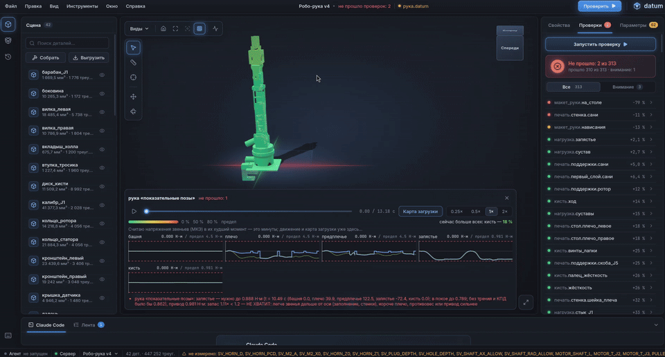

# Datum

**Русский** · [English](README.en.md)

Проектирование деталей для 3D-печати в паре с ИИ. Деталь — Python-скрипт,
числа — параметры с происхождением (намерено, угадано, выведено), а проверки
ловят то, за что иначе платят печатью: «держит» касанием вместо зацепа,
запаянную полость, тонкую стенку, защёлку без заходной фаски, деталь, которую
не собрать, звено, которому не хватит привода. Окно показывает то же, что
считают проверки, а встроенный Claude Code работает теми же операциями, что
человек.



> Проект молодой и развивается. Проверен на Linux (x86-64). Интерфейс,
> сообщения и документация — в первую очередь на русском.

## Что умеет

- **Деталь — код, а не дерево фич.** Скрипт на Python строит тело ядром
  [manifold3d](https://github.com/elalish/manifold): примитивы, булевы операции,
  фаски и скругления, резьба, надписи по шрифту, скульптура полем, Gridfinity.
- **Числа с происхождением.** Каждый параметр в `params/base.yaml` помечен:
  `measured`, `assumed` (с диапазоном), `derived`, `standard`, `chosen`.
  `datum sweep` прогоняет угаданное по диапазону и говорит, что из
  незамеренного решает дело, а что мерить незачем.
- **Проверки до печати.** Печатность в позе печати (стенка, нависания, мосты,
  полости, стол), собираемость по пути вставки, защёлки и усилие вставки, ход
  шарниров, детали машин (оси, винты, балки) и расчёт упругости методом
  конечных элементов — с вилкой, а не одним числом.
- **Окно.** Electron + three.js: штангенциркуль как в слайсере, толщина стенки,
  срез, разнесённый вид, перенос и поворот деталей мышью, версии со сравнением
  формы, карта печатности.
- **Механизмы.** Симуляция в MuJoCo: нужный момент приводов, устойчивость,
  задевания по точной геометрии, напряжения звеньев; выгрузка GLB с движением,
  MJCF и URDF.
- **Агент.** Claude Code в доке окна получает все операции Datum через MCP и
  навык с правилами. Он видит, что выделено в окне и откуда смотрит камера,
  может показать вам деталь или срез, а ИИ-критик проверяет готовый проект
  свежим взглядом.
- **Выход.** 3MF и STL в позе печати со сверкой записанного файла, нарезка
  консольным ElegooSlicer, масса по настройкам печати, сборочная инструкция в
  картинках, ведомость изделия. Проект сохраняется одним архивом `.datum`.

## Установка

Нужны: Linux, Python 3.11, Node.js 22.12+ с npm, компилятор C++ и `make` (для
нативного модуля терминала). Необязательно: [Claude Code](https://claude.com/claude-code)
(`claude` в `PATH`) — для агента в окне; ElegooSlicer — для нарезки.

```sh
git clone https://github.com/HelpFreedom/Datum.git
cd Datum
python3.11 -m venv .venv
.venv/bin/pip install --require-hashes -r py/requirements.lock
.venv/bin/pip install --no-deps -e py
scripts/bootstrap.sh          # зависимости окна; скрипты установки — поимённо
npm run build
```

Необязательно:

```sh
make install    # команда `datum` в ~/.local/bin (терминал, dmenu, меню)
make mcp        # .mcp.json — инструменты Datum для `claude`, запущенного в репозитории
```

Подробно, с объяснением каждого шага и решением частых проблем, —
[руководство](docs/guide.md).

## Быстрый старт

```sh
datum                     # окно с пустым проектом «Без названия»
datum init ~/parts/plate  # новый пустой проект
datum ~/parts/plate       # открыть его в окне
datum examples/latch      # открыть пример
```

Без `make install` то же самое — `.venv/bin/python -m datum.cli …` для команд и
`npm start -- <проект>` для окна.

Деталь — файл в `parts/` проекта:

```python
from datum.build import P, centre_on_bed, part
from datum.geom import box, cyl_z, diff


@part("пластина", print_up="+Z")
def build():
    w = P.PLATE_W
    plate = box(-w / 2, w / 2, -w / 2, w / 2, 0, P.PLATE_T)
    hole = cyl_z(P.HOLE_D, -1, P.PLATE_T + 1)
    return centre_on_bed(diff(plate, [hole]))
```

```sh
datum build  ~/parts/plate   # собрать
datum check  ~/parts/plate   # проверки; код 1 при провале
datum sweep  ~/parts/plate   # что измерить в первую очередь
datum export ~/parts/plate   # 3MF и STL в output/, в позе печати
```

Полный пример с параметрами — в [руководстве](docs/guide.md#первый-проект).
Все команды — `datum --help`; они же инструменты агента (`mcp__datum__*`).

## Окно

Сверху — меню, состояние проекта и кнопка «Проверить». Слева — сцена (детали,
видимость, порядок сборки), импортированные модели, версии и корзина. Справа —
свойства выделенной детали, проверки (худшие сверху) и параметры с
происхождением. Снизу — Claude Code (запускается кнопкой) и лента вызовов: в
ней видно, что сделали вы и что агент.

| Клавиша | Действие |
|---|---|
| `D` | штангенциркуль: вершина, ребро, окружность (Ø), центр отверстия, грань; два элемента — расстояние или угол |
| `T` | толщина стенки (считает сервер) |
| `M` / `R` | перенос / поворот детали; это правка проекта (`placement.yaml`) |
| `E` | разнести детали / вернуть в сборку |
| `B` / `C` | собрать / проверить |
| `H` | вернуть камеру |
| `Delete`, `Ctrl+Z` | удалить деталь целиком (в корзину проекта) и вернуть |
| `Ctrl+S`, `Ctrl+Shift+S`, `Ctrl+O` | сохранить, сохранить как, проекты |
| `?` | все клавиши; буквы работают в любой раскладке |

## Примеры

| | |
|---|---|
| `examples/hello` | то, что создаёт `datum init`: пустой проект |
| `examples/latch` | коробка с защёлкой: собираемость, усилие вставки, развёртка по угаданному |
| `examples/gridfinity` | ящик с отсеками и плита под сетку 42 мм (`datum.std.gridfinity`) |
| `examples/sculpt` | подставка под шар — скульптура полем: предел уклона, узор, черновик |
| `examples/arm` | двухзвенная рука на двух сервах: симуляция механизма, балласт |
| `examples/dispenser`, `examples/spool` | проекты, перенесённые из рабочего процесса «скрипты + Claude Code»: аналитика и МКЭ, 168 канавок одним конвейером |

## Проект на диске

```
datum.toml            принтер, стол, материал
params/base.yaml      параметры с происхождением
parts/*.py            скрипты деталей
lib/                  общие помощники проекта
assembly.yaml         порядок сборки, способ постановки, шарниры
checks/checks.yaml    проверки из каталога (`datum checks`)
NOTES.md, JOURNAL.md  рассуждения и журнал решений
.datum/, output/      кеш и выгрузка (в архив не идут)
```

## Устройство репозитория

```
py/datum/      бэкенд: geom (ядро), build, doc, checks, fem, sim, io, viz,
               std, tools (реестр операций), server, mcp
apps/shell/    оболочка Electron (TypeScript)
apps/ui/       окно: Vite + React + three.js
plugin/        плагин Claude Code: навык, критик, аудит, хуки
examples/      примеры проектов
scripts/       запуск, сценарии проверки окна, бюджеты, опись зависимостей
docs/          руководство, архитектура, охрана, замеры GPU
```

Подробное устройство — [docs/architecture.md](docs/architecture.md), что
защищено и что нет — [docs/security.md](docs/security.md).

## Тесты

```sh
make check   # тесты бэкенда и окна, бюджеты времени, самопроверка МКЭ
make ui      # сценарии в живом окне (нужен дисплей)
make audit   # лицензии и известные уязвимости зависимостей (нужна сеть)
```

## Авторы

- **Black Triangle** ([@HelpFreedom](https://github.com/HelpFreedom)) — автор и владелец проекта
- **Claude** (Anthropic) — соавтор кода и документации

Как предложить правку — [CONTRIBUTING.md](CONTRIBUTING.md).

## Лицензия

[MIT](LICENSE). Сторонние компоненты — под своими лицензиями: шрифты DejaVu
(`py/datum/assets/fonts/LICENSE-DejaVu.txt`), зависимости Python и npm (опись —
`make audit`, разбор — [docs/security.md](docs/security.md)). Необязательная
зависимость `pypardiso` тянет Intel MKL под Intel Simplified Software License.
